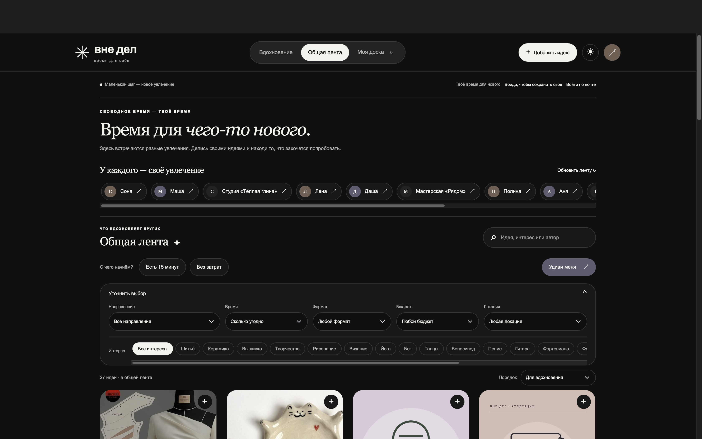

# Вне дел

**От интереса — к первой попытке.** Приложение помогает выбрать занятие под свои интересы, время и бюджет, сохранить идею и отметить результат.

## Запуск

1. Нажми **Code → Download ZIP** и распакуй архив.
2. Открой папку **Вне_дел_для_GitHub** внутри скачанного проекта.
3. Запусти **START.command** и открой **http://127.0.0.1:5174/**. Нужен Python 3, установка пакетов не требуется.
4. Нажми «Войти», выбери Анну, Соню или Мишу и введи проверочный код **1234**.

Это автономный прототип авторизации: письма не отправляются. Доски профилей разделены в интерфейсе, общие публикации видны в одном браузере. Данные сохраняются в localStorage; очистка данных сайта удаляет их. Настоящие личные пароли вводить не нужно.

## Что можно попробовать

Выбрать интересы → отфильтровать идеи → открыть материалы и первый шаг → сохранить на доску → изменить статус и добавить заметку. Можно публиковать идеи, смотреть профили, обсуждать занятия, сортировать выдачу и выбирать случайную идею с учётом фильтров.

## Материалы ИДЗ1

- [Код и подробная инструкция](Вне_дел_для_GitHub/)
- [PRD](Вне_дел_для_GitHub/PRD.md)
- [Дизайн](Вне_дел_для_GitHub/DESIGN.md) и [референс](Вне_дел_для_GitHub/submission/reference-pinterest.png)
- [Структура данных](Вне_дел_для_GitHub/ARCHITECTURE.md)
- [Путь пользователя](Вне_дел_для_GitHub/CJM.md)
- [Проверки и ограничения](Вне_дел_для_GitHub/submission/FINAL_CHECK.md)
- [Рефлексия](Вне_дел_для_GitHub/submission/REFLECTION.md) и [план видео](Вне_дел_для_GitHub/submission/VIDEO.md)

Проверки правил данных и автономного адаптера: `node --test tests/*.test.cjs` из папки приложения. 19 тестов прошли. Фактические ручные проверки перечислены в чек-листе; видео прикладывается отдельно.

Дополнительная интеграция с Supabase оставлена в режиме `?mode=cloud`; для основного сценария сдачи она не нужна. Секреты и личные данные в репозиторий не включены.
